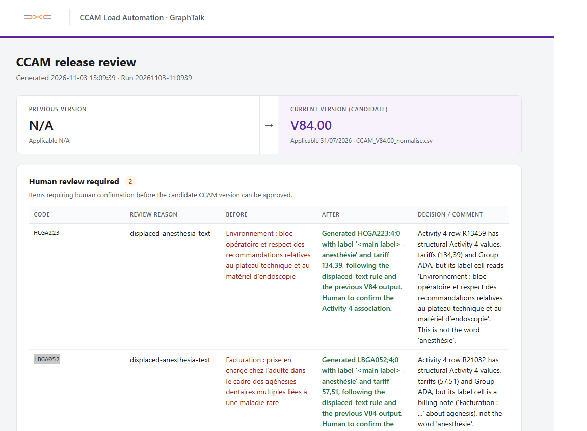
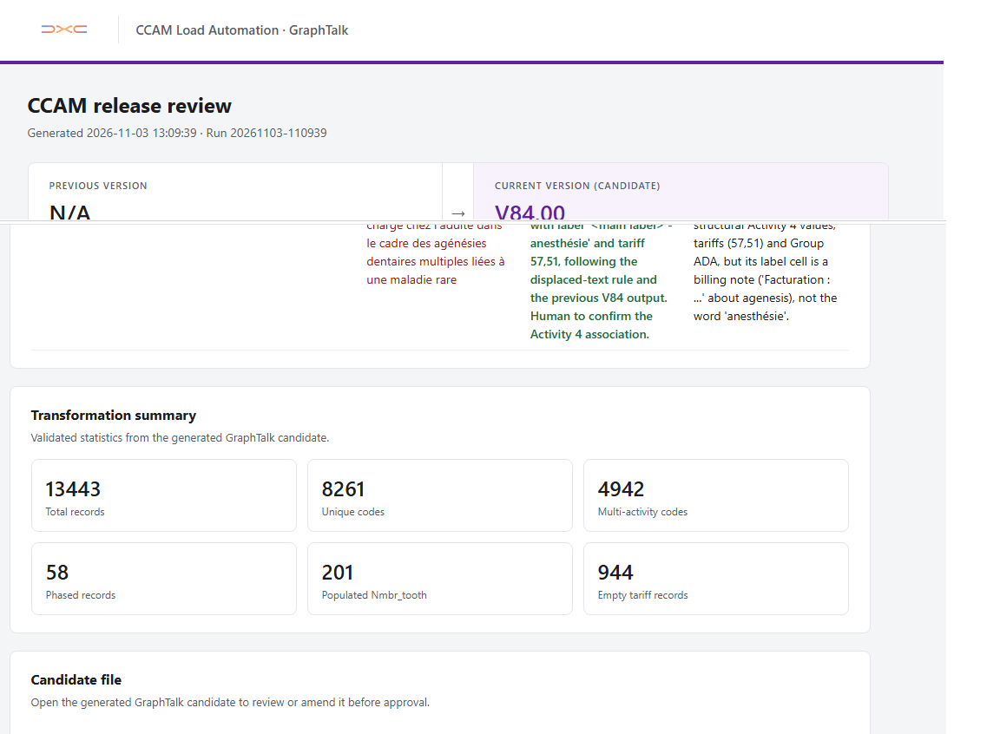

# CCAM → GraphTalk Automation

## Say Goodbye to Manual CCAM Loading

## This Repo Includes the Solution To:

- Manual checking for new CCAM versions.
- Manual transformation into a new CCAM CSV file ready for GraphTalk.
- Streamlined GraphTalk loading.

## Overview

This project automates the process of detecting, transforming, reviewing, and loading new CCAM releases into GraphTalk. It replaces a largely manual workflow with an automated pipeline that checks for new CCAM data, transforms it into the format required by GraphTalk, validates the result, generates a human-readable review report, and prepares the approved data for loading into GraphTalk.

## Quick Start

Once the prerequisites are installed and `config.json` is configured for the target environment, validate the setup:

```powershell
./check-ccam.ps1 -Validate
```

Run the normal workflow:

```powershell
./check-ccam.ps1
```

To run the complete workflow using the local test workbook instead of downloading the current CCAM file:

```powershell
./check-ccam.ps1 -Test
```

When a new CCAM workbook is detected and successfully processed, the workflow generates the GraphTalk candidate and HTML review report and sends a notification through Outlook.

Open the review report, inspect the generated candidate, and submit it to GraphTalk when ready.

For unattended execution, configure Windows Task Scheduler as described in [Setup & Prerequisites](#setup--prerequisites).

## Table of Contents

- [Architecture](#architecture)
- [Workflow](#workflow)
- [Project Structure](#project-structure)
- [CCAM Transformation](#ccam-transformation)
- [Validation](#validation)
- [Human Review](#human-review)
- [GraphTalk Integration](#graphtalk-integration)
- [Automation / Scheduling](#automation--scheduling)
- [Configuration](#configuration)
- [Setup & Prerequisites](#setup--prerequisites)
- [Running Locally](#running-locally)
- [Test & Validation Modes](#test--validation-modes)
- [Error Handling & Logging](#error-handling--logging)
- [Design Decisions](#design-decisions)
- [Technologies](#technologies)
- [Current Status / Limitations](#current-status--limitations)

## Architecture

```text
CCAM Source
    ↓
PowerShell Orchestration
    ↓
Claude Transformation
    ↓
Deterministic Validation
    ↓
HTML Review Package
    ↓
Human Review
    ↓
GraphTalk
```

## Workflow

1. **Download the latest CCAM workbook**  
   The workflow downloads the current CCAM Excel workbook from the official source.

2. **Compare the file hash**  
   A hash is calculated for the downloaded workbook and compared with the hash of the previously processed version. If the hashes match, no further processing is required. If they differ, the new workbook continues through the pipeline.

3. **Clean the previous working files**  
   Temporary and generated files from the previous run are removed before the new transformation begins.

4. **Transform with Claude**  
   Claude Code uses the custom `ccam-transform` skill to process the workbook and generate structured transformation output.

5. **Generate and validate the candidate**  
   The transformation result is converted into the semicolon-delimited CSV format required by GraphTalk. The candidate is validated before the workflow continues.

6. **Generate the review package**  
   The workflow creates an HTML review report alongside the candidate CSV so the generated output can be inspected.

7. **Notify the reviewer**  
   An Outlook notification is sent when the candidate is ready for review. Failures during the automated workflow also trigger an error notification via Outlook.

8. **Human review**  
   The reviewer uses the generated HTML report to inspect the transformation before initiating the load.

9. **Load into GraphTalk**  
   The approved candidate is submitted to GraphTalk through its SOAP interface.

## Project Structure

```text
ccam-load-gt/
│
├── .claude/
│   └── skills/
│       └── ccam-transform/
│           └── SKILL.md
│
├── Context/
│   ├── ccam-review-report.template.html
│   ├── logo.jpg
│   └── XML request example.xml
│
├── input/
│   └── ccam-current.xls
│
├── schemas/
│   ├── ccam-metadata-response.schema.json
│   └── ccam-transform-response.schema.json
│
├── scripts/
│   └── New-CcamReviewReport.ps1
│
├── state/
│   └── workflow.json
│
├── work/
│
├── .gitignore
├── check-ccam.ps1
├── CLAUDE.md
├── config.json
├── LICENSE
├── README.md
├── run-ccam-hidden.vbs
└── task.log
```

### Key Components

- **`check-ccam.ps1`**  
  Main orchestration script. Controls the end-to-end CCAM workflow.

- **`.claude/skills/ccam-transform/SKILL.md`**  
  Custom Claude Code skill containing the instructions for interpreting and transforming CCAM data.

- **`schemas/`**  
  JSON schemas defining the structured outputs expected from the Claude transformations.

- **`scripts/New-CcamReviewReport.ps1`**  
  Generates the HTML report used to review the transformed CCAM candidate before loading.

- **`Context/`**  
  Supporting resources supplied to the workflow, including the HTML review template and GraphTalk XML request example.

- **`input/ccam-current.xls`**  
  The currently downloaded CCAM workbook used as the source for processing.

- **`state/workflow.json`**  
  Persists the minimal workflow state between executions, including the previously processed CCAM hash.

- **`work/`**  
  Temporary working directory containing intermediate and generated files for the current run.

- **`config.json`**  
  Central configuration for the automation.

- **`run-ccam-hidden.vbs`**  
  Launches the automation without displaying a PowerShell console, intended for unattended execution through Windows Task Scheduler.

- **`task.log`**  
  Captures output from scheduled and unattended executions for troubleshooting.

## CCAM Transformation

Instead of encoding the entire CCAM transformation logic directly into PowerShell, the project delegates the interpretation of the CCAM workbook to Claude Code.

A custom `ccam-transform` skill defines the transformation rules and instructs Claude how to process the source workbook. Claude returns a structured JSON response validated against the schemas in `schemas/`.

This creates a clear separation of responsibilities:

- **PowerShell** controls the workflow.
- **Claude Code** interprets and transforms the CCAM data.
- **JSON schemas** enforce the expected structure of the AI output.
- **Validation** verifies the generated candidate before it can proceed to review.

## Validation

Before a generated CCAM candidate can proceed to human review, the workflow validates the transformation output and the final CSV.

The validation step acts as a safety boundary between the AI-assisted transformation and GraphTalk. It checks that the generated output follows the expected structure and that the candidate file satisfies the format required by GraphTalk.

The final candidate is checked for requirements such as:

- Expected number of fields per record.
- Semicolon-delimited structure.
- Required values and valid record structure.
- Correct file encoding and line endings.
- Detection of malformed or unexpected output.

If validation fails, the workflow stops and reports the error instead of allowing an invalid candidate to continue toward GraphTalk.

This ensures that Claude performs the transformation, but deterministic validation decides whether its output is acceptable.

## Human Review

The workflow intentionally keeps a human-in-the-loop before any generated CCAM data is loaded into GraphTalk.

After transformation and validation succeed, `New-CcamReviewReport.ps1` generates an HTML review report from the structured transformation results. The report provides a human-readable view of the proposed CCAM update together with access to the generated candidate file.

The reviewer can inspect the detected changes, transformation results, validation outcome, and any relevant warnings before deciding whether the candidate should be loaded.

Once the review package is ready, the workflow sends an Outlook notification to the reviewer. The actual GraphTalk load remains a deliberate user action rather than an automatic consequence of the AI transformation.

The final boundary is:

```text
AI Transformation → Deterministic Validation → Human Review → GraphTalk Load
```
### Review Report

The generated review report provides the reviewer with the CCAM version change, items requiring human confirmation, and validated transformation statistics.



The same report provides access to the generated candidate and the action used to submit the reviewed candidate to GraphTalk.



## GraphTalk Integration

After human review, the generated candidate can be submitted to GraphTalk directly from the HTML review report.

The integration builds a SOAP request and sends it to the configured GraphTalk endpoint using the existing `GraphTalkRunTrx` mechanism.

The request invokes:

- **Package:** `rfrnc`
- **Theme:** `trx_upgrade`
- **Transaction:** `load_rfrnc_param_vals`
- **Type:** `ccam_ro`
- **Mode:** `save`
- **Candidate path:** supplied through `file_name`

The integration does not modify the underlying GraphTalk data directly. It submits the generated candidate to the existing GraphTalk transaction, which remains responsible for processing and loading the reference data.

Because the request is sent from the browser in `no-cors` mode, the review page cannot inspect the SOAP response or confirm the final GraphTalk transaction result. The page only confirms that the load request was submitted. The final result must be verified on the GraphTalk side.

## Automation / Scheduling

The CCAM check is designed to run unattended using Windows Task Scheduler.

The scheduled task launches `run-ccam-hidden.vbs`, which starts the PowerShell automation without displaying an interactive console window. `check-ccam.ps1` then performs the normal workflow, beginning with downloading the latest CCAM workbook and comparing its hash with the previously processed version.

If the workbook has not changed, the run ends without starting a new transformation. If a change is detected, the full transformation and review workflow begins.

Output from unattended executions is written to `task.log`, while relevant workflow notifications and failures can also be sent via Outlook. Together, these provide visibility into scheduled executions and make failures easier to diagnose.

This allows the system to check for new CCAM releases automatically while keeping the actual GraphTalk load behind the human review step.

## Configuration

Runtime configuration is stored in `config.json`, keeping environment-specific values and paths separate from the main automation logic.

The configuration is divided into five sections:

- **`test`**  
  Defines the local CCAM Excel file used when running the workflow in test mode.

- **`source`**  
  Defines the CCAM source URL and the workbook location used to extract the CCAM version. The current configuration reads the version from sheet `CCAM`, cell `E1`.

- **`paths`**  
  Defines the locations of workflow resources and output directories, including:
  - Workflow state
  - JSON transformation schema
  - Claude transformation skill
  - Review report generator
  - HTML report template
  - Input directory
  - Working directory
  - Final review/output directory

- **`graphTalk`**  
  Defines the GraphTalk endpoint used when submitting an approved candidate.

- **`connector`**  
  Defines the reviewer and technical contact used for workflow notifications.

The configuration allows paths, endpoints, contacts, and source information to be changed without modifying the orchestration scripts.

> **Note:** `state/workflow.json` is not configuration. It contains runtime state maintained between executions, while `config.json` defines how the automation should operate.

## Setup & Prerequisites

### PowerShell

The automation requires **PowerShell 7**.

The scheduled workflow is launched through `run-ccam-hidden.vbs`, which starts the project using the PowerShell 7 executable:

```text
C:\Program Files\PowerShell\7\pwsh.exe
```

### Claude Code

Claude Code must be installed, configured, and available through `PATH` for the Windows user running the automation.

Verify that the CLI is available:

```powershell
claude --version
```

The project transformation skill must remain available at:

```text
.claude/skills/ccam-transform/SKILL.md
```

After setup, run Validation Mode:

```powershell
./check-ccam.ps1 -Validate
```

Validation Mode verifies both that the Claude CLI is available and that Claude can read the project's `ccam-transform` skill.

### Outlook

Microsoft Outlook must be installed and configured for the Windows user running the automation.

The workflow uses Outlook COM to send review and failure notifications. Outlook must therefore be able to send email programmatically without requiring user confirmation.

Run Validation Mode after setup to verify that an email can be sent successfully:

```powershell
./check-ccam.ps1 -Validate
```

### Windows Task Scheduler

The automation can be scheduled using Windows Task Scheduler.

The current setup runs the CCAM check once per day at **08:00**.

#### General

Create a task named:

```text
CCAM Daily Check
```

Configure the task to:

- Run under the Windows account that has access to the project, Outlook, and required network resources.
- Select **Run only when user is logged on**.
- Configure the task for **Windows Server 2025**.
- Highest privileges are not required.

> The task runs only while the configured user is logged on. This is required by the current Outlook COM-based notification setup.

#### Trigger

Create a daily trigger:

```text
Daily at 08:00
```

#### Action

Create a **Start a program** action with:

**Program/script:**

```text
C:\Windows\System32\wscript.exe
```

**Add arguments:**

```text
"<PROJECT_ROOT>\run-ccam-hidden.vbs"
```

**Start in:**

```text
<PROJECT_ROOT>
```

Example:

```text
D:\Users\ddraganov\ccam-load-gt
```

`run-ccam-hidden.vbs` launches the PowerShell workflow without displaying a console window during scheduled execution.

#### Conditions

No additional idle, power, wake, or network conditions are required.

#### Settings

Enable:

- **Allow task to be run on demand**
- **Run task as soon as possible after a scheduled start is missed**
- **If the running task does not end when requested, force it to stop**

For overlapping executions, use:

```text
Do not start a new instance
```

After creating the task, run it manually once and check `task.log` to confirm that the scheduled execution completes successfully.

## Running Locally

The workflow can be executed manually from the repository root using PowerShell 7:

```powershell
pwsh ./check-ccam.ps1
```

A normal run uses the settings defined in `config.json` and follows the same workflow as a scheduled execution:

1. Download the latest CCAM workbook.
2. Compare its hash against the previously processed version.
3. If a change is detected, clean the working directory and start the transformation.
4. Validate the generated candidate.
5. Generate the HTML review report.
6. Send the review notification through Outlook.

The generated working files are stored under `work/`, while the final review package is written to the `reviewDirectory` configured in `config.json`.

Running the script manually is useful during development and troubleshooting because the PowerShell output is immediately visible instead of running silently through Windows Task Scheduler.

## Test & Validation Modes

The workflow provides separate modes for testing the CCAM pipeline and validating the execution environment.

### Test Mode

When test mode is enabled, the workflow bypasses the external CCAM download and uses the local workbook configured under `test.excelFile` in `config.json`.

The test workbook is configured in `config.json`:

```json
"test": {
  "excelFile": "input/CCAM_V84_VF.xls"
}
```

Run it from the project root with:

```powershell
./check-ccam.ps1 -Test
```

The remaining transformation, validation, report generation, and notification workflow is then executed normally.

This makes test mode useful for repeatable development and troubleshooting, since a known CCAM workbook can be processed without depending on the availability or content of the external source.

### Validation Mode

Validation mode performs a pre-flight check without downloading or transforming a CCAM workbook.

Run it with:

```powershell
./check-ccam.ps1 -Validate
```

or using the shorter alias:

```powershell
./check-ccam.ps1 -v
```

Validation mode verifies that:

- `config.json` exists, contains valid JSON, and includes the required source and connector settings.
- `state/workflow.json` exists and contains valid JSON.
- The transformation skill, transformation schema, and review report script exist at their configured paths.
- The Claude CLI is installed and available through `PATH`.
- Claude can read `.claude/skills/ccam-transform/SKILL.md`.
- The transformation response schema contains valid JSON.
- Outlook COM integration can create and send a validation review notification to the configured reviewer.

Validation mode does not transform a workbook or generate a real review report. The Outlook test uses the placeholder path `VALIDATION_ONLY_NO_REPORT.html`.

A successful run ends with:

```text
Validation completed successfully.
```

Both modes write their execution output to `task.log`.

## Error Handling & Logging

The automation is designed to fail safely and provide enough information to diagnose unattended executions.

### Logging

Every execution creates a PowerShell transcript in `task.log`:

```text
=== CCAM START 2026-11-03 08:00:00 ===
...
=== CCAM END 2026-11-03 08:00:15 ===
```

The transcript captures the output of the workflow, including detected versions, hash comparisons, transformation progress, generated artifacts, validation results, warnings, and failures.

This is particularly useful when the workflow is executed silently through Windows Task Scheduler.

### Error Handling

PowerShell is configured with:

```powershell
$ErrorActionPreference = "Stop"
```

The main workflow is wrapped in a `try/catch` block so terminating errors stop execution instead of allowing the pipeline to continue with incomplete or invalid data.

Additional checks are performed throughout the workflow for conditions such as:

- Missing or invalid configuration and state files.
- Missing transformation skill, schema, or report generator.
- CCAM download failures.
- Missing or invalid CCAM workbooks.
- Claude CLI failures or invalid structured output.
- Failed transformation validation.
- Missing candidate files.
- Review report generation failures.

Errors from external processes such as `curl` and Claude are captured and included in the reported failure where available.

### Failure Notifications

When the workflow fails, the error is written to `task.log` and an Outlook notification is sent to the configured `technicalContact`.

The notification includes:

- Failure reason.
- PowerShell error location.
- Current workflow status.
- Detected CCAM version.
- Computer and user running the automation.
- Execution time.
- Script path.

If Outlook itself cannot send the failure notification, the problem is written as a warning to the execution log instead.

This means an unattended failure has two diagnostic paths: **the local `task.log` transcript and the Outlook failure notification**.

## Design Decisions

Several implementation choices were driven by the environment in which the automation needs to run and by the goal of keeping the solution relatively simple.

### Why PowerShell?

PowerShell was chosen as the main orchestration layer because the automation runs in a Windows environment and needs to interact with Windows-native components such as Excel, Outlook, the filesystem, and Windows Task Scheduler.

It also provides a lightweight way to coordinate the different parts of the workflow without introducing another application or service that would need to be deployed and maintained.

### Why Claude?

Claude Code was chosen because its agentic workflow fits the transformation problem well. It can work directly with the project files, follow the reusable `ccam-transform` skill, process the CCAM workbook, generate the required candidate file, and return a structured result to the PowerShell orchestration layer.

This allows the complex CCAM transformation rules to remain in a dedicated skill rather than being hardcoded into the orchestration script.

Claude was also a natural choice given DXC's existing relationship with Anthropic and the availability of Claude within the enterprise environment.

### Why Outlook COM?

Outlook COM was chosen because Outlook was already available in the Windows environment, providing a simple way to send workflow notifications without additional services.

### Why Hash-Based Change Detection?

The downloaded CCAM workbook is identified as changed by comparing its SHA-256 hash with the hash of the previously processed workbook.

This makes change detection independent of the CCAM filename or version metadata. If the source workbook itself changes, the workflow detects it.

### Why Human Review?

The workflow intentionally stops short of making the GraphTalk update completely autonomous.

Transformation, validation, report generation, and notification are automated, but the generated candidate can be inspected before the GraphTalk load is initiated.

This keeps a human decision between the AI-assisted transformation and the target system.

### Why Use the Existing GraphTalk Transaction?

The automation does not reproduce GraphTalk's reference-data loading logic externally or attempt to update the underlying data directly.

Instead, it submits the generated candidate through the existing `GraphTalkRunTrx` SOAP interface and the established `load_rfrnc_param_vals` transaction.

This keeps the automation focused on preparing the CCAM candidate while leaving the actual reference-data processing to GraphTalk.

## Technologies

- **PowerShell 7** - Main workflow orchestration, validation, configuration, and error handling.
- **Claude Code** - AI-assisted CCAM transformation using the custom `ccam-transform` skill and structured JSON output.
- **Microsoft Excel COM** - Reading CCAM workbook metadata.
- **Microsoft Outlook COM** - Review and failure email notifications.
- **HTML / CSS / JavaScript** - Human review interface and GraphTalk load submission.
- **SOAP / XML** - Communication with the GraphTalk transaction interface.
- **JSON / JSON Schema** - Configuration, workflow state, and structured Claude output.
- **Windows Task Scheduler** - Scheduled unattended execution.
- **VBScript** - Hidden launch of the scheduled PowerShell workflow.
- **cURL** - Downloading the latest CCAM workbook.
- **SHA-256** - Detecting changes to the source CCAM workbook.

## Current Status / Limitations

- GraphTalk submission from the HTML cannot confirm the SOAP transaction result because of no-cors.
- Final load success must be verified in GraphTalk.
- Outlook COM requires Outlook to be configured for the execution user.
- Scheduled Outlook notifications currently require that user to be logged on.
- Claude Code must be installed/configured on the execution machine.
- The VBS launcher currently contains machine-specific paths.
- The unattended Claude Code transformation currently uses `--dangerously-skip-permissions` to allow file generation, validation scripts, and artifact creation without interactive approval prompts. Claude still runs with the permissions of the Windows account executing the scheduled task.